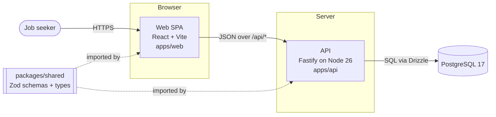
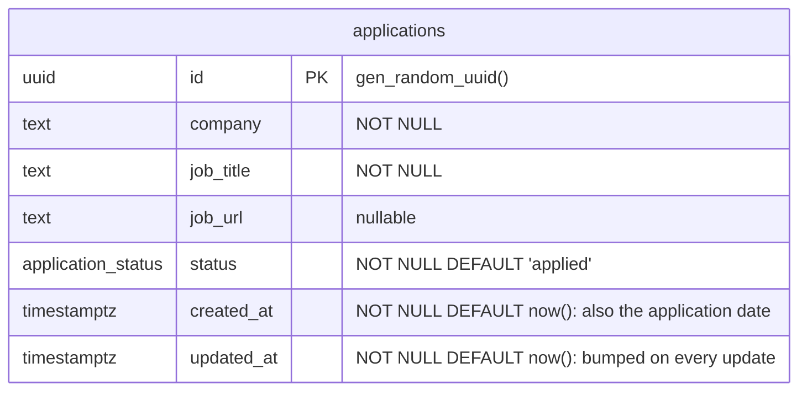
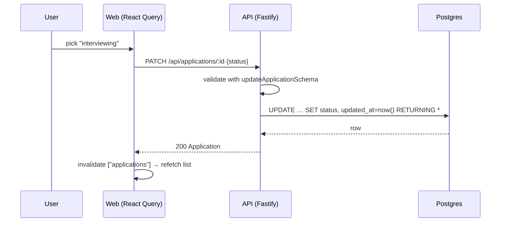

# Architecture

> **Living document.** This describes the system as it is _right now_. Update it in the same PR
> as any change to the components, data model, API, or infrastructure. The reasoning behind each
> choice lives in [ADRs](adr/README.md). Each dependency's alternatives are in
> [dependencies.md](dependencies.md).

_Last updated: 2026-10-31_

## 1. What the system does

Interview App tracks software-engineering job applications: the company, the role, a link to the
job description, where the application stands, and when it was created and last changed.

## 2. Requirements and scale assumptions

| Dimension      | Now                                                           | Planned                    |
| -------------- | ------------------------------------------------------------- | -------------------------- |
| Users          | 1 (no auth yet, [ADR-0009](adr/0009-defer-authentication.md)) | ~12, possibly ~1,000s      |
| Rows per user  | hundreds                                                      | low thousands              |
| Read/write mix | read-heavy (list view), occasional writes                     | same                       |
| Availability   | local dev only                                                | single region, best effort |

**Back-of-envelope estimate at the high end.** 5,000 users × 2,000 applications = 10M rows ×
~300 bytes ≈ 3 GB including indexes. Peak traffic is perhaps 5,000 users × 50 requests/day ≈
250k requests/day ≈ 3 req/s on average, maybe 30 req/s at peak. **One small Postgres instance and
one API process handle that easily.** At this scale the design challenges are correctness,
tenant isolation, and operability, not throughput. Section 8 lists what would change if that
stopped being true.

## 3. System context and containers

| Container         | Responsibility                                                | Tech                         |
| ----------------- | ------------------------------------------------------------- | ---------------------------- |
| `apps/web`        | UI. Server state is cached and refetched with TanStack Query. | React 19, Vite 8             |
| `apps/api`        | HTTP API, input validation, persistence                       | Fastify 5, Drizzle ORM, `pg` |
| `packages/shared` | API contract: Zod schemas, TS types, status list              | Zod 4                        |
| PostgreSQL        | System of record                                              | Postgres 17 (Docker locally) |

In local dev, Vite proxies `/api/*` to the API, so the browser sees one origin and there is no
CORS setup. Production will keep the same-origin approach (section 7).

## 4. Data model

- `application_status` is a Postgres enum: `applied → screening → interviewing → offer →
accepted`, plus the terminal states `rejected` and `withdrawn`. Any status can move to any
  other; transitions aren't enforced yet. See [ADR-0006](adr/0006-status-enum-and-dates.md).
- Index `applications_updated_at_idx (updated_at)` serves the default "most recently updated
  first" list. When users arrive it becomes `(user_id, updated_at DESC)`.
- Source of truth: `apps/api/src/db/schema.ts`. Migrations are generated into `apps/api/drizzle/`
  ([ADR-0004](adr/0004-drizzle-orm-and-migrations.md)).

## 5. API

All routes are JSON under `/api`. Request bodies are validated with the shared Zod schemas
([ADR-0005](adr/0005-shared-zod-contract.md)).

| Method | Path                    | Success | Errors                                    |
| ------ | ----------------------- | ------- | ----------------------------------------- |
| GET    | `/api/health`           | 200     | (reports `db: "down"` instead of failing) |
| GET    | `/api/applications`     | 200     |                                           |
| GET    | `/api/applications/:id` | 200     | 404 for an unknown or malformed id        |
| POST   | `/api/applications`     | 201     | 400 for invalid input                     |
| PATCH  | `/api/applications/:id` | 200     | 400, 404                                  |
| DELETE | `/api/applications/:id` | 204     | 404                                       |

The list isn't paginated. That's fine for hundreds of rows per user, and cursor pagination on
`(updated_at, id)` is the planned next step.

## 6. Request flow: changing a status

## 7. Environments and delivery

| Environment | Status            | Notes                                                                                                                                                                                                                                                          |
| ----------- | ----------------- | -------------------------------------------------------------------------------------------------------------------------------------------------------------------------------------------------------------------------------------------------------------- |
| Local       | ✅ running        | `docker compose` Postgres (databases `app` and `app_test`), `pnpm dev`                                                                                                                                                                                         |
| CI          | ✅ GitHub Actions | `check` job (required): lint, format, typecheck, dependency register, migration drift, tests against Postgres. Also CodeQL and dependency review on every PR, and weekly Dependabot update PRs ([ADR-0010](adr/0010-public-repo-and-supply-chain-scanning.md)) |
| Production  | ⏳ not yet        | Hosting decision pending (it will be its own ADR)                                                                                                                                                                                                              |

## 8. Known limits and what changes at scale

| Trigger                         | Change                                                                                                                   |
| ------------------------------- | ------------------------------------------------------------------------------------------------------------------------ |
| More than one user              | Auth, `user_id` foreign key on `applications`, every query scoped by user ([ADR-0009](adr/0009-defer-authentication.md)) |
| Need for history and analytics  | Append-only `application_events` table, so `updated_at` stops being the only trace                                       |
| Lists in the thousands per user | Cursor pagination, plus server-side filter and sort                                                                      |
| Read load beyond one Postgres   | Connection pooling (PgBouncer), then a read replica. Caching only if measurements show it's needed                       |
| Multiple API instances          | Already stateless, so add a load balancer and scale horizontally                                                         |
