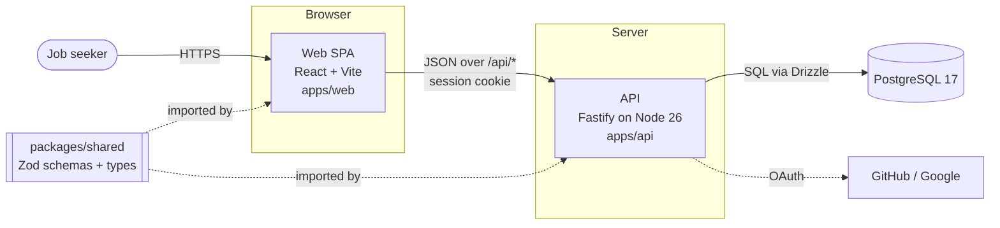
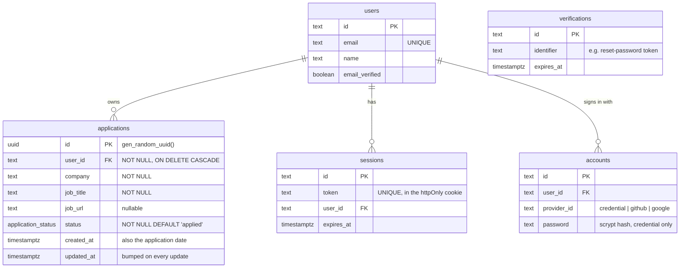
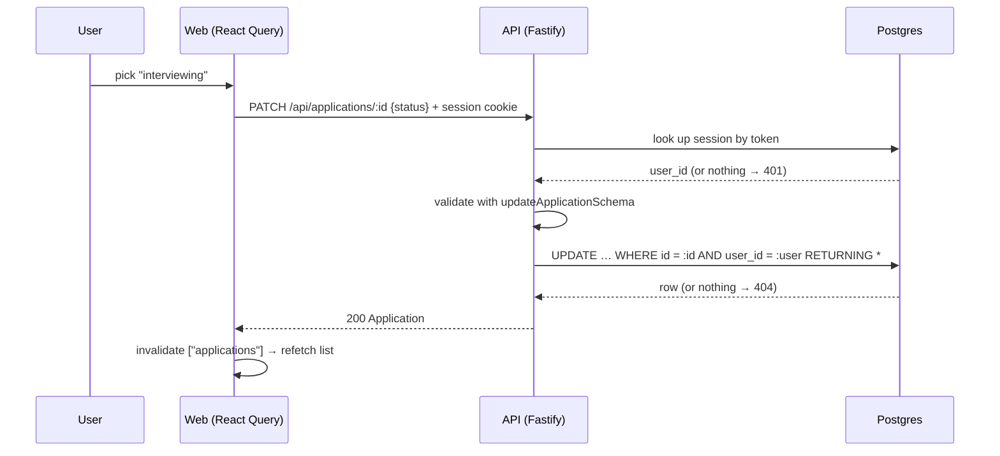
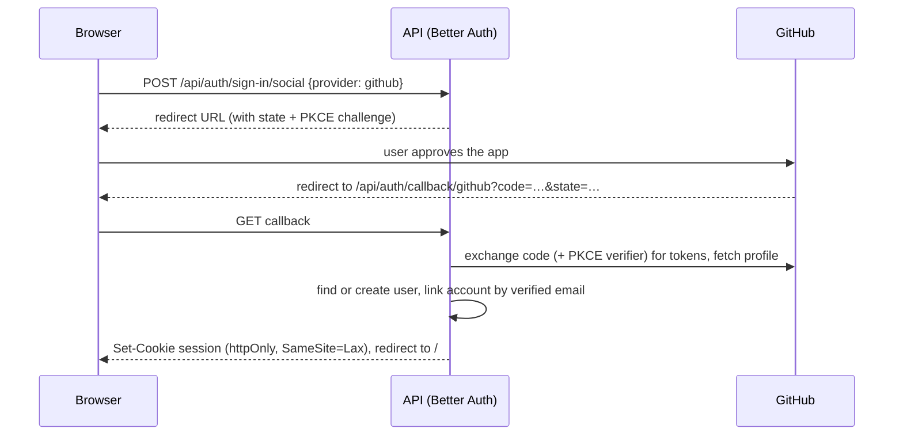
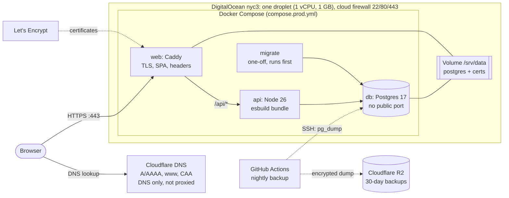
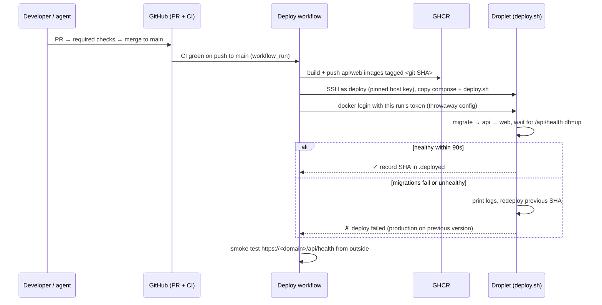

# Architecture

> **Living document.** This describes the system as it is _right now_. Update it in the same PR
> as any change to the components, data model, API, or infrastructure. The reasoning behind each
> choice lives in [ADRs](adr/README.md). Each dependency's alternatives are in
> [dependencies.md](dependencies.md).

_Last updated: 2026-11-05_

## 1. What the system does

Interview App tracks software-engineering job applications: the company, the role, a link to the
job description, where the application stands, and when it was created and last changed. Each
user signs in (email and password, GitHub, or Google) and only ever sees their own applications.

## 2. Requirements and scale assumptions

| Dimension      | Now                                                                  | Planned                      |
| -------------- | -------------------------------------------------------------------- | ---------------------------- |
| Users          | multi-user with auth ([ADR-0011](adr/0011-authentication.md))        | ~12, possibly ~1,000s        |
| Rows per user  | hundreds                                                             | low thousands                |
| Read/write mix | read-heavy (list view), occasional writes                            | same                         |
| Availability   | single VPS, ~99.5–99.9% ([ADR-0012](adr/0012-hosting-single-vps.md)) | same until users demand more |

**Back-of-envelope estimate at the high end.** 5,000 users × 2,000 applications = 10M rows ×
~300 bytes ≈ 3 GB including indexes. Peak traffic is perhaps 5,000 users × 50 requests/day ≈
250k requests/day ≈ 3 req/s on average, maybe 30 req/s at peak. **One small Postgres instance and
one API process handle that easily.** At this scale the design challenges are correctness,
tenant isolation, and operability, not throughput. Section 8 lists what would change if that
stopped being true.

## 3. System context and containers

| Container         | Responsibility                                                | Tech                                      |
| ----------------- | ------------------------------------------------------------- | ----------------------------------------- |
| `apps/web`        | UI. Server state is cached and refetched with TanStack Query. | React 19, Vite 8                          |
| `apps/api`        | HTTP API, auth (sessions, OAuth), validation, persistence     | Fastify 5, Better Auth, Drizzle ORM, `pg` |
| `packages/shared` | API contract: Zod schemas, TS types, status list              | Zod 4                                     |
| PostgreSQL        | System of record                                              | Postgres 17 (Docker locally)              |

In local dev, Vite proxies `/api/*` to the API, so the browser sees one origin and there is no
CORS setup. Production will keep the same-origin approach (section 7).

## 4. Data model

- **Tenant isolation:** every `applications` query filters on `user_id` from the session. Another
  user's ids return 404, never 403, so the API doesn't confirm they exist. Tested in
  `apps/api/test/auth.test.ts`.
- `users`, `sessions`, `accounts` and `verifications` are shaped by Better Auth
  ([ADR-0011](adr/0011-authentication.md)). One user can have several `accounts` (a password plus
  GitHub, say), which is how account linking works.
- `application_status` is a Postgres enum: `applied → screening → interviewing → offer →
accepted`, plus the terminal states `rejected` and `withdrawn`. Transitions aren't enforced
  ([ADR-0006](adr/0006-status-enum-and-dates.md)).
- Index `applications_user_id_updated_at_idx (user_id, updated_at DESC)` serves the only list
  query: one user's applications, newest first.
- Source of truth: `apps/api/src/db/schema.ts`. Migrations are generated into `apps/api/drizzle/`
  ([ADR-0004](adr/0004-drizzle-orm-and-migrations.md)).

## 5. API

All routes are JSON under `/api`. Request bodies are validated with the shared Zod schemas
([ADR-0005](adr/0005-shared-zod-contract.md)).

| Method   | Path                    | Auth    | Success | Errors                                                                |
| -------- | ----------------------- | ------- | ------- | --------------------------------------------------------------------- |
| GET      | `/api/health`           | public  | 200     | (reports `db: "down"` instead of failing)                             |
| GET      | `/api/auth-config`      | public  | 200     | (lists enabled social providers)                                      |
| GET/POST | `/api/auth/*`           | public  | varies  | Better Auth: sign-up/in/out, OAuth callbacks, password reset, session |
| GET      | `/api/applications`     | session | 200     | 401                                                                   |
| GET      | `/api/applications/:id` | session | 200     | 401, 404 (unknown, malformed, or not yours)                           |
| POST     | `/api/applications`     | session | 201     | 400, 401                                                              |
| PATCH    | `/api/applications/:id` | session | 200     | 400, 401, 404                                                         |
| DELETE   | `/api/applications/:id` | session | 204     | 401, 404                                                              |

The list isn't paginated. That's fine for hundreds of rows per user, and cursor pagination on
`(updated_at, id)` is the planned next step.

## 6. Request flows

### Changing a status

### Signing in with GitHub (OAuth 2.0 authorization code flow)

### Security properties

- **Sessions** are opaque random tokens stored in Postgres. They go in an `httpOnly`,
  `SameSite=Lax` cookie, which page JavaScript can't read, so a cross-site scripting bug can't
  steal it. Sign-out deletes the row, which revokes the session immediately (unlike a JWT).
- **CSRF:** any state-changing request that carries a cookie must have an `Origin` matching
  `BETTER_AUTH_URL`, and is otherwise rejected with 403. Better Auth turns this check off when
  `NODE_ENV=test`, so the config forces it on and a test proves it.
- **Passwords:** at least 10 characters, hashed with scrypt by Better Auth. Reset tokens are
  single-use and expire.
- **Brute force:** Better Auth's rate limiter (in-memory, production only) throttles auth
  endpoints. With more than one API instance it would need shared storage
  ([ADR-0011](adr/0011-authentication.md)).
- **Email verification:** email/password sign-ups get no session until they click a link sent to
  their address, so every account's email is proven (account linking depends on it). Emails go
  through Resend from `mail.<domain>`, signed with DKIM under a DMARC `quarantine` policy. In
  development they're written to the API log instead ([ADR-0017](adr/0017-email-resend.md)).
- **Password reset** signs out every other session.
- **Email abuse:** at most 5 reset or verification requests and 10 sign-ups per IP per hour
  (Better Auth, in memory), then at most 3 emails of each kind per address and 80 in total per
  24 hours (Postgres, survives deploys). Over a limit the email is silently dropped
  ([ADR-0018](adr/0018-email-sending-limits.md)).

## 7. Environments and delivery

### Production deployment

- **Edge:** Caddy terminates TLS with automatic Let's Encrypt certificates, redirects HTTP and
  `www` to `https://<domain>`, serves the SPA (hashed assets cached for a year, `index.html`
  never cached), and sets HSTS, CSP, frame-deny and related headers.
- **Startup order:** `db` healthy → `migrate` exits 0 → `api` healthy → `web` starts. A failed
  migration means the new API never starts.
- **DNS:** records point straight at the reserved IP (Cloudflare's proxy is off). The CAA record
  allows Let's Encrypt; Cloudflare automatically adds its own CAs to that set.
- **Backups:** nightly, a GitHub Actions job streams `pg_dump` over SSH, encrypts it with age,
  uploads it to R2 (30-day retention, 7-day write-once lock), then restores that copy into a
  throwaway Postgres to prove it works. RPO 24 h, RTO about 15 min
  ([ADR-0015](adr/0015-backups.md)).
- **Email:** Resend's HTTP API, from `no-reply@mail.<domain>`. The API refuses to start in
  production without its key ([ADR-0017](adr/0017-email-resend.md)).
- **Not yet:** monitoring ([roadmap](roadmap.md), phase 2).
- **Disposable server:** IPs and the data volume are separate OpenTofu resources, so the server
  can be replaced at any time ([infra/README.md](../infra/README.md)).
- **Infrastructure state:** OpenTofu state is in R2, encrypted on the operator's machine before
  upload and locked during runs ([ADR-0016](adr/0016-remote-encrypted-state.md)).

### Delivery pipeline

Rollback restores code only; migrations must stay backward-compatible with the previous release
([ADR-0014](adr/0014-push-based-deploys.md)).

| Environment | Status                              | Notes                                                                                                                                                                                                                                                                             |
| ----------- | ----------------------------------- | --------------------------------------------------------------------------------------------------------------------------------------------------------------------------------------------------------------------------------------------------------------------------------- |
| Local       | ✅ running                          | `docker compose` Postgres (databases `app` and `app_test`), `pnpm dev`. The production stack also runs locally: `docker compose -f compose.prod.yml` with `DOMAIN=localhost`.                                                                                                     |
| CI          | ✅ GitHub Actions                   | `check` (required): lint, format, typecheck, dependency register, migration drift, tests. `images`: both production images build. `infra`: `tofu fmt` + `validate`. Also CodeQL, dependency review and Dependabot ([ADR-0010](adr/0010-public-repo-and-supply-chain-scanning.md)) |
| Production  | ✅ live at https://roundtableapp.us | DigitalOcean + Cloudflare via OpenTofu ([ADR-0012](adr/0012-hosting-single-vps.md), [ADR-0013](adr/0013-digitalocean-instead-of-hetzner.md)); every green CI run on `main` deploys with health-checked rollback ([ADR-0014](adr/0014-push-based-deploys.md))                      |

## 8. Known limits and what changes at scale

| Trigger                         | Change                                                                                                            |
| ------------------------------- | ----------------------------------------------------------------------------------------------------------------- |
| Need for history and analytics  | Append-only `application_events` table, so `updated_at` stops being the only trace                                |
| Lists in the thousands per user | Cursor pagination, plus server-side filter and sort                                                               |
| One server's CPU or RAM         | Bigger `server_type` (vertical scaling, minutes of downtime), then Postgres on its own server                     |
| Read load beyond one Postgres   | Connection pooling (PgBouncer), then a read replica. Caching only if measurements show it's needed                |
| Multiple API instances          | Already stateless (sessions live in Postgres), so add a load balancer. Move the rate limiter to Postgres or Redis |
