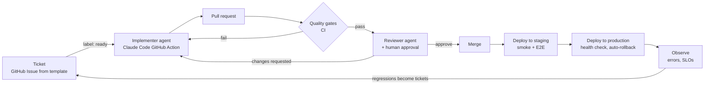

# Roadmap

Goals: (1) learn systems design, (2) deploy to production for real, (3) build a **software
factory**: write a ticket, and an automated pipeline implements, verifies and ships it to a high,
measurable quality bar.

Each phase ends in something running. Bigger decisions get an ADR when they're made.

## Phase 1: Multi-user auth ✅

Better Auth with email/password, GitHub and Google, and per-user data isolation.
[ADR-0011](adr/0011-authentication.md).

## Phase 2: Production on a single VPS 🏗️

Decided: DigitalOcean (ADR-0013, superseding Hetzner in ADR-0012), a domain on Cloudflare DNS, OpenTofu with cloud-init, Cloudflare R2 for off-site storage. The rest of the details go
in a hosting ADR when built.

1. ✅ **Containers**: multi-stage Dockerfiles. The API runs as a Node image with a non-root user.
   The web app is built to static files served by Caddy. A `compose.prod.yml` wires Caddy, the
   API and Postgres together.
2. ✅ **Infrastructure as code** (applied 2026-11-05; state is still local until it moves to R2) (`infra/`, OpenTofu): DigitalOcean droplet, firewall (only 22/80/443
   open), SSH key, a reserved IP, a data volume, and DNS records. cloud-init installs Docker, creates a deploy
   user, disables password SSH, and turns on unattended security upgrades.
3. ✅ **Edge**: Caddy terminates TLS with automatic Let's Encrypt certificates, serves the SPA,
   reverse-proxies `/api/*`, and sets security headers (HSTS, CSP).
4. ✅ **Delivery pipeline** (live: first deploy to https://roundtableapp.us on 2026-11-05) ([ADR-0014](adr/0014-push-based-deploys.md)): on merge to `main`, GitHub Actions builds the images, tags them with the
   git SHA, and pushes them to GitHub Container Registry. A deploy job then runs migrations as a
   one-off container, rolls the API, health-checks `/api/health`, and rolls back if that fails.
   Production is a protected GitHub Environment holding the secrets.
5. **Data safety**: nightly `pg_dump` to object storage with retention, plus a **tested restore**
   (a backup you haven't restored isn't a backup). OpenTofu state moves to the same R2 account.
6. **Email**: a real provider (Resend) on the domain, with SPF/DKIM/DMARC records, then turn on
   required email verification.
7. **Observability (minimum)**: structured logs, an external uptime check, and error tracking
   (Sentry free tier, or self-hosted GlitchTip).

Cost: $6/month droplet + ~$1 volume + $0 R2 (free tier) ≈ **$7/month**, plus the domain.

## Phase 3: The software factory

The target loop:

Building blocks, in order:

1. **Ticket template**: a GitHub Issue form with problem, user story, acceptance criteria
   (Given/When/Then), out of scope, and a "docs impact" field. Good tickets are the single biggest
   lever on agent output quality.
2. **Implementer**: the Claude Code GitHub Action runs when an issue gets the `ready` label. It
   reads `CLAUDE.md`, implements on a branch, and opens a PR linked to the issue. It can be
   re-triggered by review comments.
3. **Reviewer**: a second agent with a different prompt and no stake in the implementation
   reviews every PR against the ticket's acceptance criteria and the repo rules. It posts inline
   comments, then a human approves (you stay in the loop at first).
4. **Staging environment**: a second deploy target on the same VPS or a second small one. Every
   merge goes to staging first, and production follows automatically if staging is healthy.
5. **Continuous operation**: scheduled agent runs that triage Dependabot PRs, fix flaky tests,
   and turn production errors into tickets.

## What "ensuring quality" can mean

Quality comes in layers. Each answers a different question, and they compound. Already in place
is marked ✅.

| Layer                       | Question it answers                                        | Tools                                                                  | Status                                        |
| --------------------------- | ---------------------------------------------------------- | ---------------------------------------------------------------------- | --------------------------------------------- |
| Static checks               | Is the code well-formed?                                   | TypeScript strict, ESLint, Prettier                                    | ✅                                            |
| Contract                    | Do the frontend and backend agree?                         | Shared Zod schemas                                                     | ✅                                            |
| Integration tests           | Does the API behave correctly against a real DB?           | Vitest + Postgres                                                      | ✅                                            |
| Security scanning           | Known-vulnerable deps? Injection bugs?                     | Dependabot, dependency review, CodeQL                                  | ✅                                            |
| Docs as a gate              | Is the "why" recorded?                                     | Dependency register check, PR template, ADRs                           | ✅                                            |
| **Acceptance tests**        | Does it do what the ticket asked?                          | Playwright E2E, one test per acceptance criterion                      | Phase 3                                       |
| **Coverage gate**           | Is new code exercised at all?                              | Vitest coverage, with a threshold on changed lines                     | Phase 3                                       |
| **Mutation testing**        | Would the tests catch a bug? Coverage can't tell you that. | Stryker                                                                | Phase 3: the best signal for AI-written tests |
| **AI code review**          | Does it match the ticket, the conventions and good design? | Reviewer agent with a checklist                                        | Phase 3                                       |
| **Visual regression**       | Did the UI change unexpectedly?                            | Playwright screenshots                                                 | Later                                         |
| **Accessibility**           | Is it usable with a keyboard or screen reader?             | axe-core in Playwright                                                 | Phase 3 (cheap)                               |
| **Performance budgets**     | Did it get slower or heavier?                              | Lighthouse CI, bundle size limits, API latency tests                   | Later                                         |
| **Production verification** | Does it work for real users?                               | Smoke tests after deploy, error rates, SLOs with alerts, auto-rollback | Phase 2–3                                     |
| **DORA metrics**            | Is the factory itself healthy?                             | Deploy frequency, lead time, change failure rate, time to restore      | Later: the factory's own dashboard            |

Guiding principle: **an agent should never be the only judge of its own work.** Every gate above
is either deterministic (a test, a type check) or independent (a separate reviewer agent, a
human, production metrics).
