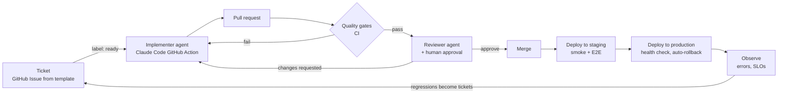

# Roadmap

Goals: (1) learn systems design, (2) deploy to production for real, (3) build a **software
factory**: write a ticket, and an automated pipeline implements, verifies and ships it to a high,
measurable quality bar.

Each phase ends in something running. Bigger decisions get an ADR when they're made.

## Phase 1: Multi-user auth ✅

Better Auth with email/password, GitHub and Google, and per-user data isolation.
[ADR-0011](adr/0011-authentication.md).

## Phase 2: Production on a single VPS 🏗️

Decided: DigitalOcean (ADR-0013, superseding Hetzner in ADR-0012), a domain on Cloudflare DNS, OpenTofu with cloud-init, Cloudflare R2 for off-site storage. The rest of the details go
in a hosting ADR when built.

1. ✅ **Containers**: multi-stage Dockerfiles. The API runs as a Node image with a non-root user.
   The web app is built to static files served by Caddy. A `compose.prod.yml` wires Caddy, the
   API and Postgres together.
2. ✅ **Infrastructure as code** (applied 2026-11-05; encrypted state in R2) (`infra/`, OpenTofu): DigitalOcean droplet, firewall (only 22/80/443
   open), SSH key, a reserved IP, a data volume, and DNS records. cloud-init installs Docker, creates a deploy
   user, disables password SSH, and turns on unattended security upgrades.
3. ✅ **Edge**: Caddy terminates TLS with automatic Let's Encrypt certificates, serves the SPA,
   reverse-proxies `/api/*`, and sets security headers (HSTS, CSP).
4. ✅ **Delivery pipeline** (live: first deploy to https://roundtableapp.us on 2026-11-05) ([ADR-0014](adr/0014-push-based-deploys.md)): on merge to `main`, GitHub Actions builds the images, tags them with the
   git SHA, and pushes them to GitHub Container Registry. A deploy job then runs migrations as a
   one-off container, rolls the API, health-checks `/api/health`, and rolls back if that fails.
   Production is a protected GitHub Environment holding the secrets. Merges that ship nothing
   (docs, Markdown, `infra/`) don't deploy. **Later: zero-downtime deploys.** Today every deploy
   recreates the API and Caddy, so the site is down for about 10 seconds. Instead: start the new API
   next to the old one, switch Caddy's upstream once `/api/health` is up, then stop the old one,
   and keep Caddy running throughout. Migrations already have to be backward-compatible with the
   previous release, which is exactly what running both versions at once needs.
5. ✅ **Data safety** ([ADR-0015](adr/0015-backups.md)): nightly `pg_dump` to object storage with retention, plus a **tested restore**
   (a backup you haven't restored isn't a backup). OpenTofu state is in R2 too, encrypted ([ADR-0016](adr/0016-remote-encrypted-state.md)).
6. ✅ **Email** ([ADR-0017](adr/0017-email-resend.md)): Resend from `mail.<domain>` with
   SPF/DKIM/DMARC records in OpenTofu, and required email verification.
7. ✅ **Observability (minimum)** ([ADR-0019](adr/0019-monitoring-and-error-tracking.md)):
   structured logs (Pino), a Better Stack uptime check and backup heartbeat (in OpenTofu), and
   Sentry error tracking for the API. Later: searchable log history, browser errors.

Cost: $6/month droplet + ~$1 volume + $0 R2 (free tier) + $0 Resend (free tier, 3,000 emails a
month) + $0 Better Stack and Sentry (free tiers) ≈ **$7/month**, plus the domain.

## Next: the API on Effect

Decided in [ADR-0022](adr/0022-effect-for-the-api.md), with the evidence in the
[spike findings](research/2026-11-effect-spike.md). Each step is its own PR, keeps `pnpm check`
green, and updates `CLAUDE.md` and `docs/architecture.md` as it changes them:

1. **Drizzle 1.0 on the current Fastify app:** bump `drizzle-orm` and `drizzle-kit` to the release
   candidate (exact pins), convert the migrations folder once with `drizzle-kit up` (byte-identical
   SQL), switch to `drizzle({ client })`, turn on `paramsInErrors`, and update #29's leak tests for
   1.0's error format. Measured in the spike as 4 lines of code. It goes first because it's
   independent of Effect and shrinks the later steps.
2. ✅ **Foundation:** `effect` and `@effect/*` pinned exactly and grouped in Dependabot. Effect's
   language service runs as `pnpm check:effect` (`@effect/tsgo`, since TypeScript 7 can't load
   the classic plugin), in `pnpm check` and CI, and works in editors through the same tsconfig
   plugin entry. Also the anti-slop Effect rules, `@effect/vitest`, and an "Effect conventions"
   section in `CLAUDE.md` built from the spike's gotchas.
3. ✅ **Contract:** the `HttpApi` definition, written with Effect Schema, in `packages/shared`
   (now `@roundtable/shared`). The Zod schemas stayed until the web app moved (step 5).
   `contract.test.ts` keeps the two in step: same input accepted and rejected, real responses
   decode, same endpoints as Fastify. Writing it also exposed that `jobUrl` accepted
   `javascript:` URLs; both schemas now allow only `http(s)`.
4. ✅ **Server:** `HttpApi` replaces Fastify, in two PRs. 4a moved every test onto a
   framework-neutral `t.inject()`; 4b swapped the server under it, and the same tests passed
   unchanged except the planned 400 for malformed ids. The `Authorization` middleware provides
   `CurrentUser`; Better Auth is mounted with `fromWebHandler`; Sentry gets Effect's failures
   through our own `ErrorReporter` (not the alpha `@sentry/effect`), and expected errors set the
   ignore marker; Effect's logs go through pino and its redaction. 400s are RFC 9457 problems
   that name the invalid value. `server.test.ts` checks the production wiring on a real Node
   server.
5. ✅ **Web:** the web app calls the API through the client generated from the contract
   (`@roundtable/shared/client`), inside TanStack Query; the Zod contract is gone. A follow-up removed
   Zod entirely: `env.ts` reads the environment through Effect `Config`, with every secret
   (database URL, auth secret, OAuth client secrets, Resend key, Sentry DSN) kept `Redacted` so
   it can't leak through a log line or an error, and `redact.ts` uses Effect Schema. The client checks request bodies before sending
   them, which exposed that `Schema.Trim` refuses to _encode_ untrimmed text: company and job
   title now trim in both directions. `client.test.ts` runs the client against the real server.
   Bundle: 115 → 155 KB gzipped, as the ADR estimated.
6. ✅ **Email as Effect services:** an `EmailTransport` (Resend, the log, or a test's capture)
   under a `Mailer` that applies the sending limits in one Effect transaction. Resend is called
   with Effect's HttpClient and retried, three attempts in all, on what its docs say is worth
   retrying (5xx, the per-second rate limit, a concurrent request with the same key, a network
   failure), never on a 4xx or a used-up quota. One idempotency key per email makes a retry
   after a timeout safe: Resend delivers it once. Failures and the daily-limit alarm reach Sentry
   through the `ErrorReporter`, tagged with the email kind. Better Auth's callbacks reach the
   `Mailer` through a Promise bridge. The spike's interrupted-transaction test is back as
   `test/database.test.ts`, since the limits' lock depends on it.

**Later: `@sentry/effect` instead of our own reporter.** ADR-0022 named `@sentry/effect`; step 4b
uses our own `ErrorReporter` (`SentryErrorReporter` in `apps/api/src/platform/observability/error-tracking.ts`, about 15
lines on `@sentry/node`) instead. The reasons: the package is alpha, we'd use only its reporter,
it initialises Sentry itself (in place of our tuned `initErrorTracking`), and it pins
`@sentry/node` to its own exact version. Migrate when **any** of these becomes true:

- **We want tracing:** request latency, slow queries, or SLOs for the factory's "Observe" step.
  Its `SentryEffectTracer` turns Effect's spans into Sentry traces, which our reporter can't do.
- **It's stable** (no longer marked alpha), so it's no riskier than `@sentry/node`.
- **It reports something ours doesn't**, for example the route and method on every event. A
  database-outage event currently loses the request, because Better Auth reports first and
  Sentry deduplicates the second report.
- **Ours breaks on an Effect upgrade** (the `ErrorReporter` API is marked unstable) while theirs
  keeps up.

The move: replace `SentryErrorReporter` with `Sentry.effectLayer(...)`, passing it today's
`initErrorTracking` options (minimal `dataCollection`, `beforeSend: scrubEvent`, console
breadcrumbs off), and keep `@sentry/node` on its exact version. It's done when the Sentry tests
pass unchanged, especially `test/server.test.ts` (the real server, every log line and event
checked for the session token) and the outage tests in `platform/observability/error-tracking.test.ts`.

## Modular monolith ✅

[ADR-0023](adr/0023-modular-monolith-layout.md): both apps are organized by module, so a module
can later become its own service, and the web app its own repo or several microfrontends,
without untangling anything first.

1. ✅ **Layout:** the API in `modules/{applications,identity,email}` plus `platform/`, with
   colocated tests and each module's tables in its own `schema.ts` (no migration). The contract
   is `@roundtable/contract`, one file per module. The web app is `shell/`, `modules/` and
   `shared/`. `pnpm check:boundaries` enforces the import rules.
2. **Design system:** themed, reusable components in `apps/web/src/design-system/` (tokens,
   theme, components), consumed by every web module through its `index.ts`. Its own ADR first:
   styling approach, unstyled primitives for accessibility, theme switching, and whether to add
   Storybook. It's the first part likely to become a package (`packages/design-system`) once
   microfrontends build separately.

## Phase 3: The software factory

The target loop:

Building blocks, in order:

1. **Ticket template**: a GitHub Issue form with problem, user story, acceptance criteria
   (Given/When/Then), out of scope, and a "docs impact" field. Good tickets are the single biggest
   lever on agent output quality.
2. **Implementer**: the Claude Code GitHub Action runs when an issue gets the `ready` label. It
   reads `CLAUDE.md`, implements on a branch, and opens a PR linked to the issue. It can be
   re-triggered by review comments.
3. **Reviewer**: a second agent with a different prompt and no stake in the implementation
   reviews every PR against the ticket's acceptance criteria and the repo rules. It posts inline
   comments, then a human approves (you stay in the loop at first).
4. **Staging environment**: a second deploy target on the same VPS or a second small one. Every
   merge goes to staging first, and production follows automatically if staging is healthy.
5. **Continuous operation**: scheduled agent runs that triage Dependabot PRs, fix flaky tests,
   and turn production errors into tickets, and then into PRs with a failing test that reproduces
   them, without a human starting the investigation. That only works if each error carries enough
   context to reproduce it, and never any user data. Today a database error carries the SQL,
   Postgres's own fields (`code`, `table`, `constraint`), the stack, the route and the release,
   plus the kind of each query value (`uuid`, `string(32)`, `null`) but not the value itself
   ([ADR-0022](adr/0022-effect-for-the-api.md)). Next: the kinds of the request body's fields on
   every error (`jobUrl: null`, `company: string(0)`), so a validation or handler bug can be
   reproduced from the Sentry issue alone. Agents never get real values: that would expose user
   data and make stored text a prompt-injection path.
6. **Security auditor**: a scheduled agent (weekly, and on any PR that touches auth, logging,
   error tracking, `infra/` or a new external service) whose only job is to find security holes.
   It has its own prompt and no stake in the code it audits. Every finding becomes a ticket with
   a test that reproduces it. Scanners only catch known patterns. The 2026-11-10 leak passed
   CodeQL, dependency review, the tests and code review: when the database failed, Drizzle's
   error message (with the raw session token as a query parameter) went to Sentry and the
   server logs ([#29](https://github.com/brianpatterson/roundtable/pull/29)). Only exercising a
   failure on purpose and reading what left the process found it. So the auditor should:
   - **Follow data out of the process:** what reaches Sentry, the logs, emails and third-party
     APIs, and under which failures (database down, a provider erroring, bad input).
   - **Check auth and tenancy:** every route behind the session check, cross-user access is a
     404, and tokens and links are single-use and expire.
   - **Probe inputs and config:** validation gaps, injection, headers and CSP, cookie flags,
     firewall and secrets handling in `infra/`.
   - **Inject faults** to exercise error paths, the way the leak was found: take away the
     database, make the mailer throw, then inspect every outgoing event and log line.

## What "ensuring quality" can mean

Quality comes in layers. Each answers a different question, and they compound. Already in place
is marked ✅.

| Layer                       | Question it answers                                           | Tools                                                                        | Status                                        |
| --------------------------- | ------------------------------------------------------------- | ---------------------------------------------------------------------------- | --------------------------------------------- |
| Static checks               | Is the code well-formed?                                      | TypeScript strict, Oxlint, Prettier                                          | ✅                                            |
| Contract                    | Do the frontend and backend agree?                            | Shared Effect `HttpApi` contract and typed client                            | ✅                                            |
| Integration tests           | Does the API behave correctly against a real DB?              | Vitest + Postgres                                                            | ✅                                            |
| Security scanning           | Known-vulnerable deps? Injection bugs?                        | Dependabot, dependency review, CodeQL                                        | ✅                                            |
| Docs as a gate              | Is the "why" recorded?                                        | Dependency register check, PR template, ADRs                                 | ✅                                            |
| **Acceptance tests**        | Does it do what the ticket asked?                             | Playwright E2E, one test per acceptance criterion                            | Phase 3                                       |
| **Coverage gate**           | Is new code exercised at all?                                 | Vitest coverage, with a threshold on changed lines                           | Phase 3                                       |
| **Mutation testing**        | Would the tests catch a bug? Coverage can't tell you that.    | Stryker                                                                      | Phase 3: the best signal for AI-written tests |
| **AI code review**          | Does it match the ticket, the conventions and good design?    | Reviewer agent with a checklist                                              | Phase 3                                       |
| **Security audits**         | What can leak or be abused that no scanner knows to look for? | Security auditor agent (building block 6): data-flow review, fault injection | Phase 3                                       |
| **Visual regression**       | Did the UI change unexpectedly?                               | Playwright screenshots                                                       | Later                                         |
| **Accessibility**           | Is it usable with a keyboard or screen reader?                | axe-core in Playwright                                                       | Phase 3 (cheap)                               |
| **Performance budgets**     | Did it get slower or heavier?                                 | Lighthouse CI, bundle size limits, API latency tests                         | Later                                         |
| **Production verification** | Does it work for real users?                                  | Smoke tests after deploy, error rates, SLOs with alerts, auto-rollback       | Phase 2–3                                     |
| **DORA metrics**            | Is the factory itself healthy?                                | Deploy frequency, lead time, change failure rate, time to restore            | Later: the factory's own dashboard            |

Guiding principle: **an agent should never be the only judge of its own work.** Every gate above
is either deterministic (a test, a type check) or independent (a separate reviewer agent, a
human, production metrics).
